 

# Welcome to the Splunk4Champions Workshop!

Splunk4Champions is an interactive, hands-on Splunk workshop delivered as a Splunk app. Participants follow guided labs through a React UI embedded directly in Splunk: no separate lab portal, no external notebook, and no slide deck required for the exercises.

The workshop is built for people who already know the basics of Splunk and want to become stronger champions for their teams. It combines platform internals, SPL habits, data onboarding concepts, metrics, dashboards, mobile, AI-assisted workflows, and practical troubleshooting patterns.

## Purpose

Splunk4Champions helps experienced users move from "I can search" to "I understand how Splunk behaves and can build reliable content for others." The workshop is designed to:

- Strengthen practical SPL and search performance skills.
- Explain how Splunk stores, ages, and searches data.
- Give participants safe, curated sample datasets instead of using production data.
- Teach dashboard patterns across classic XML dashboards and Dashboard Studio.
- Introduce metrics, mobile workflows, AI Assistant, and optional MCP concepts.
- Provide a reusable enablement package for live classes, self-paced labs, and internal champion programs.

## Who should attend

- Experienced Splunk users who want to go deeper
- Splunk admins and platform owners
- Use case owners and developers
- Dashboard builders
- Internal champions who support other Splunk users
- Presales engineers or trainers who need a reusable hands-on workshop

## Quick content overview

| Chapter | Focus | Outcome |
|---------|-------|---------|
| **1 · Settings** | UI preferences, search modes, Search Assistant, AI Assistant | Tune the Splunk working environment and avoid expensive search UI habits |
| **2 · Data** | Indexes, buckets, pipeline, clustering, data aging, SmartStore | Understand how Splunk stores data and why architecture affects search behavior |
| **3 · Search** | SPL/SPL2, command types, Job Inspector, terms, `tstats`, bad searches, investigation lab, MCP | Build faster, clearer, more explainable searches |
| **4 · Dashboard Studio** | Overview, chain searches, token kitchen, image upload, custom viz exercise, sharing | Build a Studio dashboard, then a chart Studio does not ship |
| **5 · Champion Quiz** | Timed questions, instant feedback, final score | Reinforce workshop concepts and close the session with an interactive recap |
| **Legacy · Metrics** | Metric indexes, `mcollect`, `mcatalog`, `mstats`, weather, stocks, Phyphox | Compare event and metric workflows and build efficient time-series searches |
| **Legacy · XML Dashboards** | Base searches, drilldowns, tokens, annotations, colors, pseudonymization | Learn durable classic dashboard patterns still used in many Splunk estates |
| **Legacy · Mobile** | Splunk Mobile setup and overview | See how Splunk content can support mobile workflows |
| **Setup** | Health Check, Large Room, colour scheme, Readme, What's new, links, credits | Confirm the app and indexes, and set the room display |

## Lab descriptions

### Setup

The Setup chapter starts with a Health Check that validates the expected workshop indexes, event counts, metric counts, time ranges, Splunk version, and app version. It also includes the in-app Readme, What's New, follow-up links, and credits.

For trainers, the Setup page includes a Large Room display mode with larger typography and spacing for projected delivery, and a colour scheme picker (Blue / Navy, Brown / Dark Red, Blue / Yellow, Pink / Orange) on the same page.

### 1 · Settings

Participants configure Splunk preferences before deeper labs begin:

- Search Assistant
- Line numbers
- Themes
- Fast, Smart, and Verbose search modes
- Search auto-format and keyboard shortcuts
- Inline SPL comments
- User language and locale
- Splunk AI Assistant

The practical goal is to make search work easier to read, easier to teach, and less likely to create unnecessary workload.

### 2 · Data

This chapter explains the data lifecycle in Splunk:

- Indexes and buckets
- Hot, warm, cold, and frozen data
- Raw data, `tsidx`, bloom filters, and bucket metadata
- Input, parsing, indexing, and search stages
- Segmentation and `TERM()` behavior
- Schema on read: when a field exists, versus a token in tsidx
- Indexers, clustering, data aging, and SmartStore concepts

Participants learn why the same search can behave very differently depending on time range, terms, index layout, and data model.

### 3 · Search

The Search chapter is the core SPL and search-performance section. It includes:

- Search basics
- SPL2 overview and modules
- Search command types
- Job Inspector and Inspector lab
- Segmentation recap, `walklex`, and `TERM()`
- `tstats` and `PREFIX`
- Slow-search patterns and practical improvements
- A story-driven investigation lab
- Search recap / quiz
- Optional Splunk MCP Server lab

The goal is not only to teach commands, but to help participants reason about why a search is fast, slow, safe, or hard to maintain.

### Legacy · Metrics

The Metrics chapter introduces metric indexes and time-series search patterns:

- Metrics concepts
- Onboarding metrics
- `mcollect`, `mcatalog`, and `mstats`
- Weather metric data
- Stock index events converted into metrics
- Phyphox phone-sensor experiments

Participants compare event and metric representations and learn when each is the right fit.

### Legacy · XML Dashboards

Classic XML dashboards remain important in many Splunk environments. This chapter covers:

- Base searches
- Drilldowns
- Tokens
- Annotations
- Colors
- Pseudonymization / hiding user names

The goal is to teach maintainable dashboard patterns and avoid repeated expensive searches.

### 4 · Dashboard Studio

Dashboard Studio is six pages:

- Overview
- Chain searches
- Token kitchen
- Image upload
- Custom viz exercise (`@splunk/dashboard-studio-extension`, plain JavaScript)
- Sharing a dashboard without a login

### Legacy · Mobile

This chapter introduces Splunk Mobile, gateway setup, adding a device, and consuming Splunk content through mobile workflows.

### 5 · Champion Quiz

The final chapter is a Kahoot-style knowledge check with timed questions, instant feedback, and time-decayed scoring. It can be used as a live recap, a trainer-led discussion prompt, or a self-check after the workshop.

## Installation

Download the latest release from the [Releases page](https://github.com/bautt/splunk4champions2/releases/) and install as a standard Splunk app.

- Not intended for production systems — no warranty
- Current app version: **2.17.0**. Download [v2.17.0](https://github.com/bautt/splunk4champions2/releases/tag/v2.17.0) and install `splunk4champions2-2.17.0.tar.gz`.

In Splunk Web, open **Apps → Manage Apps → Install app from file**, select the
downloaded archive, and follow the prompts. Restart Splunk if prompted. Open the
workshop and check **Setup → Health Check** before running the labs.

This release is for **Splunk Enterprise only**, not Splunk Cloud. It was
checked locally on Splunk Enterprise 10.6.0.5; older Splunk versions were
not validated with the UI upgrade. The custom visualization exercise requires
Splunk Enterprise 10.4+.

If you have access to **show.splunk.com**, the workshop is available on Splunk Show.

## Running the workshop

After installation, open the lab UI from the Splunk app:

```text
https://<your-splunk>/en-GB/app/splunk4champions2/lab
```

The locale segment can differ by environment, for example `en-US` or `de-DE`.

Recommended delivery flow:

1. Open **Setup** and resolve any Health Check issues.
2. Use **Settings** to align UI preferences across participants.
3. Teach **Data** before deep **Search** labs so the performance topics have context.
4. Use **Dashboard Studio** as the practical build section. Metrics stays under Legacy.
5. Finish with the **Champion Quiz** for recap and discussion.

## Handout and flyer

Editable workshop collateral is included in Markdown format:

- [`SPLUNK4CHAMPIONS_HANDOUT_2026.md`](SPLUNK4CHAMPIONS_HANDOUT_2026.md) — participant handout
- [`SPLUNK4CHAMPIONS_FLYER_2026.md`](SPLUNK4CHAMPIONS_FLYER_2026.md) — one-page flyer source

These files are intentionally plain Markdown so they can be edited easily and exported to PDF with Pandoc, VS Code Markdown PDF, Typora, Marked, Obsidian, Word, or Google Docs.

Example:

```bash
pandoc SPLUNK4CHAMPIONS_HANDOUT_2026.md \
  -o SPLUNK4CHAMPIONS_HANDOUT_2026.pdf \
  --pdf-engine=xelatex
```

## Included datasets

The app ships with curated `s4c_*` data so labs do not depend on customer production data:

- **`s4c_stock_indices`** — up to 10 years of daily OHLCV for **9** major indexes (DAX, Dow, EURO STOXX 50, FTSE 100, Hang Seng, Nasdaq, Nikkei, S&P 500, SMI). Ingested by `update_stock_indices.py` (Yahoo chart API, stdlib only; `_time` = Unix epoch). Join `exchange_city` to `s4c_meteo_historic` on `date` + `city`.
- **`s4c_meteo_historic`** — Daily historical weather for the **seven** index `exchange_city` values (2016 → rolling; Paris/CAC removed). Shipped **`static/meteo_historic.csv`** (lookup name `meteo_historic` still works via a symlink in `lookups/`) plus **`update_meteo_historic_csv.py`** (Open-Meteo archive, daily) to keep the calendar in step with new index data. Join on `date` and `city` = `exchange_city`.
- **`s4c_meteo`** — Open-Meteo current weather as event data, useful for event search and comparison with metrics.
- **`s4c_meteo_metrics`** — Open-Meteo current weather represented as metric time series.
- **`s4c_student_metrics`** — Practice metric index populated by participants during `mcollect` labs.
- **`s4c_weather`** — Real-time OpenWeatherMap data for metrics labs.
- **`s4c_tutorial`** — Web-style tutorial logs for search and dashboard exercises.
- **`s4c_www`** — Web server logs for search, pseudonymization, and dashboard exercises.
- **`s4c_phyphox` / `s4c_phyphox_metrics`** — Optional phone sensor event and metric data via HEC.

## Recent highlights

- **2.16.0 UI refresh:** React 18.3.1, Splunk React UI 5.18.0, Search 8.0.0, and Dashboard framework 29.9.0
- Patched vulnerable transitive dependencies and removed the unused root npm lockfile
- Persistent, dismissible clipboard messages replace deprecated toast notifications
- Health Check distinguishes missing/empty indexes from permission, session, network, and timeout errors
- Lesson loading indicators and retry controls for loading or rendering failures
- Nonshrinking, horizontally scrollable navigation tabs on narrow screens
- Token Kitchen includes a simplified in-page preview and a link to the real Studio dashboard
- Large Room display mode and a visible colour scheme picker on Setup
- Live path: 1 Settings, 2 Data, 3 Search, 4 Dashboard Studio, 5 Champion Quiz
- Legacy tab for Metrics, XML Dashboards, and Mobile
- Dashboard Studio: chain searches, Token Kitchen, image upload, a custom viz exercise, and publishing
- Metrics labs with weather, stock index, and Phyphox data, under Legacy
- Standard-library stock and weather update scripts where possible

See [What's New](WHATS_NEW.md) for release details and the
[development README](README_development.md) for Node.js 22+, dependency
compatibility, and validation commands.

## Phyphox experiments

The workshop app does not ship HEC tokens. Create the optional Phyphox tokens per environment:

```ini
Token name: phyphox_metrics
Default index: s4c_phyphox_metrics
Allowed indexes: s4c_phyphox_metrics
Source type: phyphox_metrics

Optional token name: phyphox
Default index: s4c_phyphox
Allowed indexes: s4c_phyphox
Source type: phyphox_json
```

For Splunk Cloud, create HEC tokens through the Cloud-supported admin flow, such as Splunk Web or ACS.

---

## Screenshots

#### Setup — Health Check
Verify index status, event counts, and date ranges. Shows Splunk and app version at a glance.

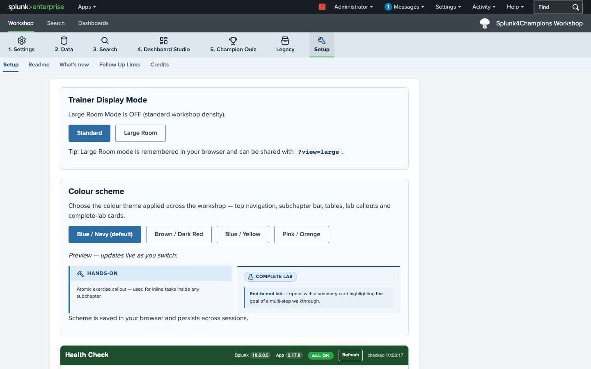

#### Chapter 1 — Settings: Search Assistant
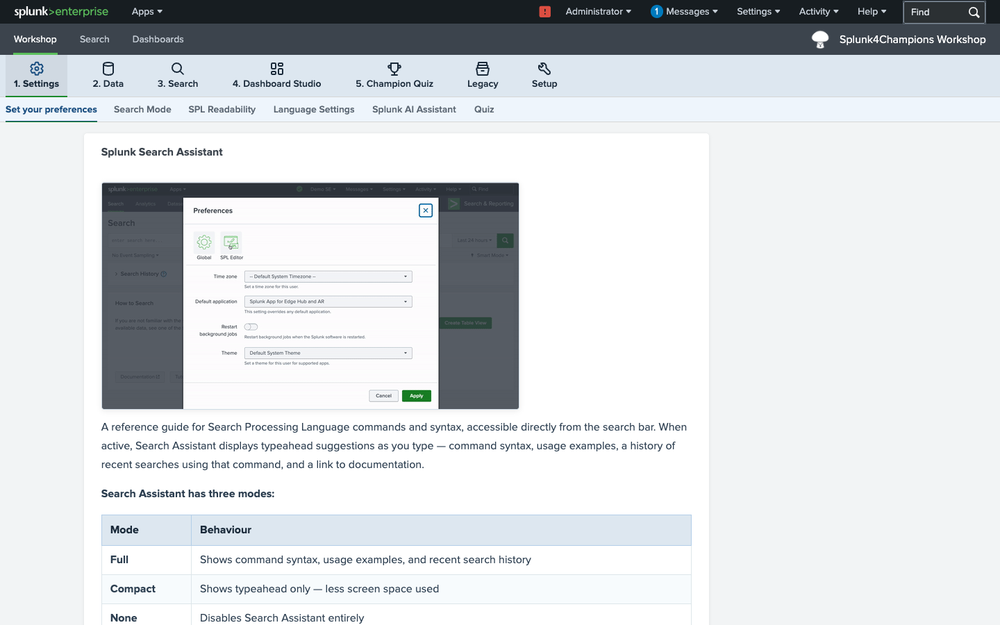

#### Chapter 1 — Settings: Search Modes
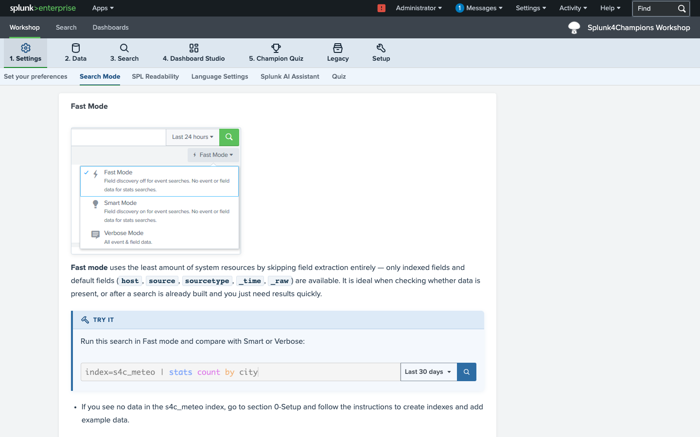

#### Chapter 2 — Data: How is data stored?
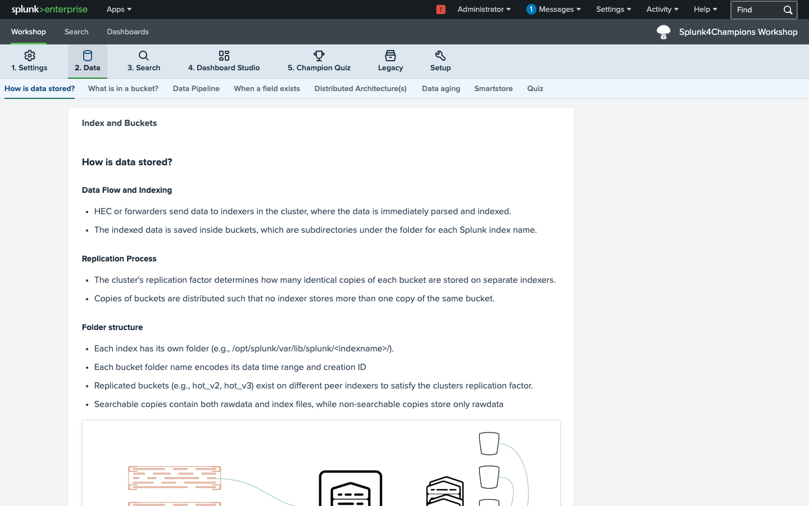

#### Chapter 2 — Data: When a field exists
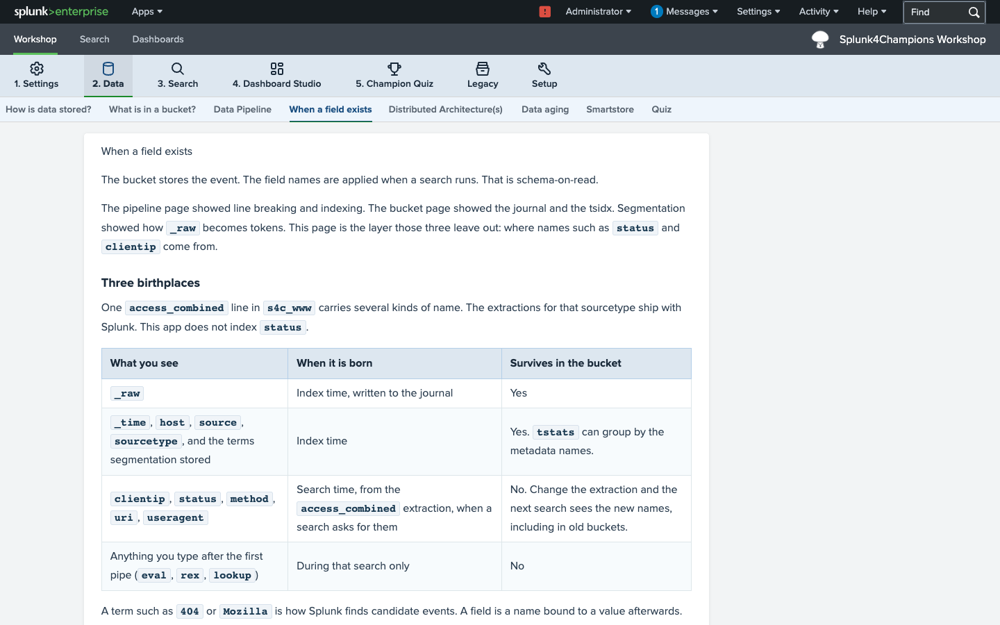

#### Chapter 3 — Search: Search Basics
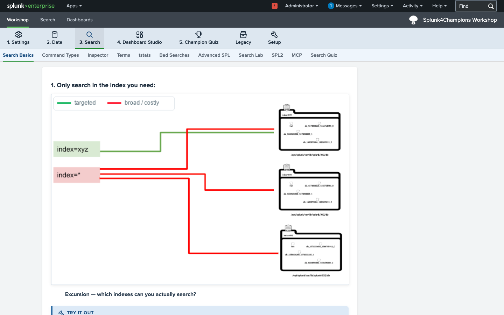

#### Chapter 3 — Search: Inspector
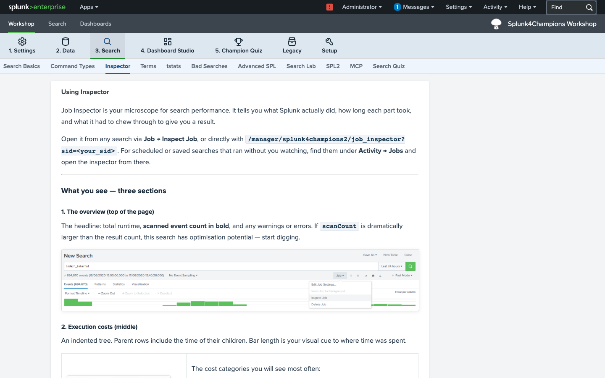

#### Chapter 3 — Search: Terms
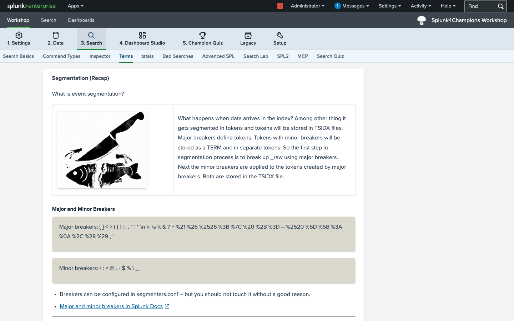

#### Chapter 3 — Search: tstats
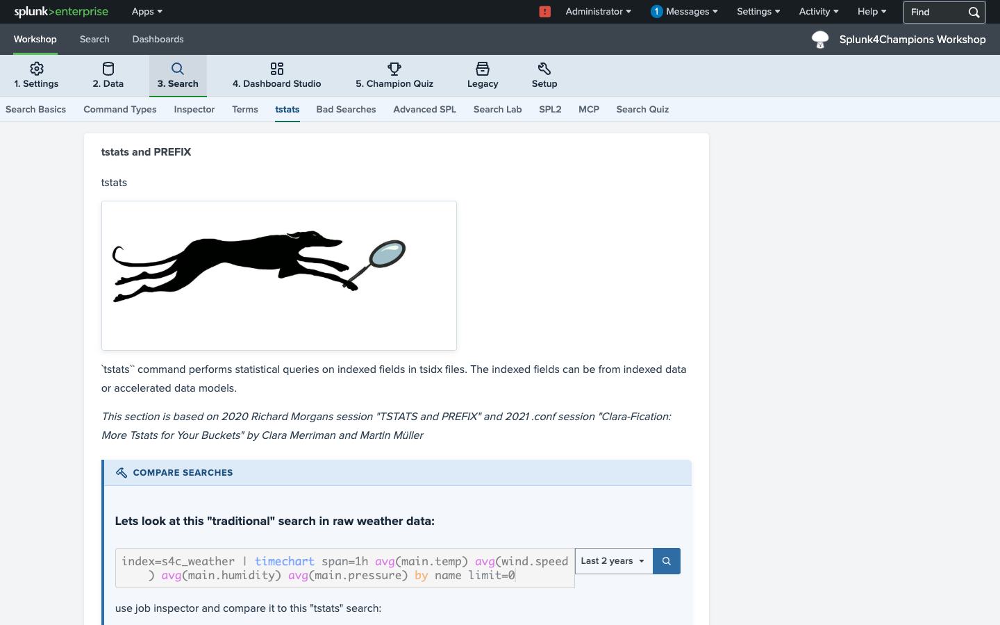

#### Legacy — Metrics: Searching Metrics
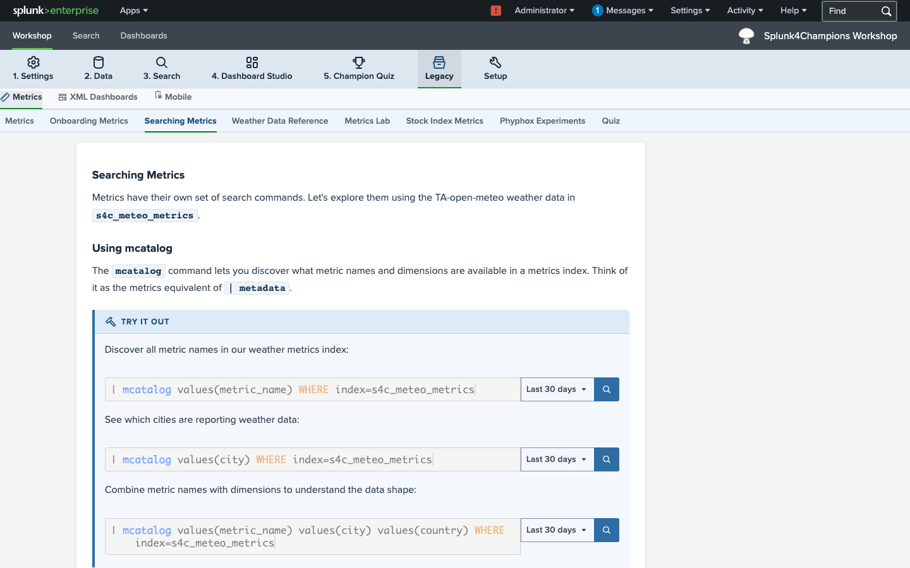

#### Legacy — XML Dashboards: Base Search
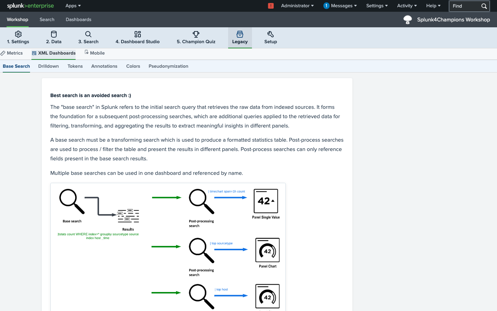

#### Chapter 4 — Dashboard Studio: Overview
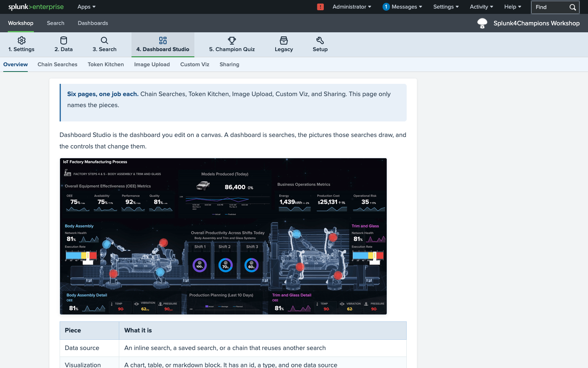

---

## Credits

Workshop content is collected, consolidated, and adapted from public .conf presentations, blog articles, and Splunk Docs. All information is provided "as is" with no guarantee of completeness, accuracy, or timeliness.

- Originally created by **Andreas Greeske** and **Tomas Baublys** in 2020
- Version 2.0 rebuilt by **Tomas Baublys** on the Splunk UI template by **Daniel Federschmidt**
- Suggestions and improvements welcome: [tbaublys@splunk.com](mailto:tbaublys@splunk.com)
- Ongoing workshop updates and refinements with **Cursor**

### Special thanks for public content
Martin Müller · Clara Merriman · Richard Morgan · and many others linked throughout the app

### Special thanks for improvements and problem solving
Dirk Nitschke · Holger Sesterhenn · Henri Mak · Lukas Utz
